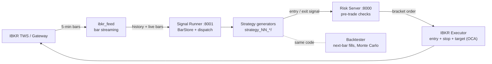

# Trade-Algo: an intraday futures trading system, built to fail safe

[](https://github.com/Tuff-Tech-coder/Trade-Algo/actions/workflows/security.yml)

An end-to-end automated trading stack for CME Micro E-mini (MES) futures on
Interactive Brokers: live market data, a pluggable strategy layer, a pre-trade
risk gate, bracket-order execution, and an event-driven backtester that runs
the **same strategy code** as production. The engineering emphasis is on what
goes wrong in real trading (stale data, duplicate signals, partial failures,
restarts), and on proving behaviour with tests that never touch a broker.

> **No performance claims.** This repository ships no market data and no P&L
> results. The strategy implements a published idea; it is not presented as
> profitable. Orders default to `PAPER` mode, and every test runs against mocks.

## Architecture



Three local processes talk over authenticated loopback HTTP. A strategy is a
folder containing a `SignalGenerator` subclass and a YAML config; the runner
auto-discovers it, and the backtester drives the identical class through a thin
adapter, so the code you test is the code you trade.

## Engineering highlights

**Execution safety** ([`shared/ibkr_executor.py`](shared/ibkr_executor.py))
- `PAPER` mode refuses to connect to a live-trading port, and requires a paper (`DU`) account.
- Entries are placed as an OCA bracket (entry + stop + target). If any leg fails to submit, the created legs are cancelled and new entries are blocked until reconciled.
- Positions, working orders and today's executions are reconciled with the broker before every entry. Stale or missing broker state blocks trading (fail closed).
- Concurrent or repeated exit requests submit exactly one close order; failed closes can be retried.
- Contracts are qualified by exact ticker, so a roll never silently substitutes another expiry.

**Risk gate** ([`shared/risk_module.py`](shared/risk_module.py))
- Drawdown floor, session window, news blackout and max-open-contracts checks run before any order. Order size is clipped to remaining capacity.
- Idempotent by signal ID: a retried signal returns the original result instead of placing a second order.
- Stale or future-dated signals are rejected.

**Strategy and data handling**
- Closed-bar semantics are consistent in live and replay (`df.iloc[-1]` is always the last *closed* bar), so there is no look-ahead.
- History seeding never dispatches signals. Duplicate timestamps replace rather than inflate history; naive or non-finite bars are rejected.
- The end-of-day flatten runs on an independent one-second timer, not on the next market-data bar.
- The strategy never substitutes a mid-morning price when the session-open bar is missing.

**Backtester** ([`backtest/`](backtest/README.md))
- Next-bar fills with adverse slippage and commission; a gap through a stop fills at the worse open price.
- When one bar touches both stop and target, the stop wins (OHLC data cannot show which traded first).
- Worst-case intrabar equity drives drawdown; Monte Carlo (bootstrap or shuffle) over the trade sequence; a sub-period walker for consistency checks; self-contained HTML reports.

**Security** ([`SECURITY.md`](SECURITY.md))
- Loopback-only clients and Host headers, constant-time key comparison, separate keys for signals, bars and admin writes, bodies bounded while streaming, API docs disabled, blank or placeholder keys fail closed.

**Supply chain and CI** ([`.github/workflows/security.yml`](.github/workflows/security.yml))
- Hash-locked dependencies (`--require-hashes`), GitHub Actions pinned by commit SHA, weekly `pip-audit`, and a publication guard (`tools/publication_guard.py`) that scans the working tree and full git history for keys, tokens, account IDs and personal paths. It runs as a pre-commit hook and in CI.

## The strategy

[`strategy_01_MES_INTRADAY_MOMENTUM`](strategy_01_MES_INTRADAY_MOMENTUM/signal_generator.py)
implements the intraday-momentum effect described in Gao, Han, Li & Zhou,
*Market Intraday Momentum* (Journal of Financial Economics, 2018). It anchors on
the 09:30 ET session open, builds an ATR-scaled noise band around it, and enters
in the direction of a close outside the band. It takes at most one trade per
session, uses an ATR stop and an R-multiple target, can gate entries on a
volatility ratio or news days, and flattens before the close. Parameters are in
[`risk_config.yaml`](strategy_01_MES_INTRADAY_MOMENTUM/risk_config.yaml).

## Testing

```powershell
python -m pip --isolated install --require-hashes --only-binary=:all: -r shared/requirements.lock
python -X utf8 -B -m unittest discover -s tests -v
python tools/publication_guard.py
```

53 offline tests mock IBKR and HTTP routing and never open a broker connection.
They cover executor idempotency and bracket failure handling, stale-state
gating, risk-server capacity and replay protection, feed timezone handling,
the simulator's stop/gap/ambiguity rules, and the publication guard itself.
Tested on Python 3.13 (`ib_insync` does not currently import on 3.14).

[`ibkr-offline-demo.html`](ibkr-offline-demo.html) is a static page walking
through five synthetic execution edge cases (stop fills, gaps, ambiguous bars,
daily loss limits). Open it in any browser; it needs no server.

## Project layout

```
Trade-Algo/
├── ibkr_feed/            TWS bar streaming and contract resolution
├── shared/               risk server, signal runner, IBKR executor, indicators, security
├── strategy_01_MES_INTRADAY_MOMENTUM/   signal generator + config
├── backtest/             event-driven simulator, Monte Carlo, report generator
├── tests/                offline regression and security tests
├── tools/                publication guard
└── docs/OPERATIONS.md    setup, running, maintenance, hardening notes
```

## Status and limitations

Stated plainly, because they matter for anything touching real money:

- **Not validated end to end on a live paper account.** Bracket/OCA behaviour, partial fills, account updates and reconnect recovery still need paper-trading verification (see the [roadmap](docs/OPERATIONS.md#roadmap)).
- No automatic reconnection: a feed or executor disconnect requires a restart.
- The simulator does not model latency, exchange queueing or partial fills.
- State and de-duplication live in memory, so the services run as a single worker on localhost only. They are not designed to be exposed to a network.
- Market data and generated reports are intentionally excluded from the repo.

## Documentation

- [Operations guide](docs/OPERATIONS.md): setup, configuration, running, maintenance
- [Backtest guide](backtest/README.md) and [IBKR feed guide](ibkr_feed/README.md)
- [Security model](SECURITY.md)
